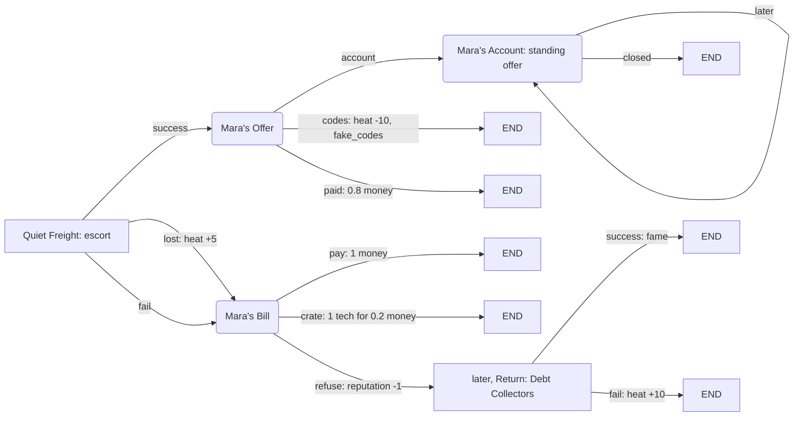
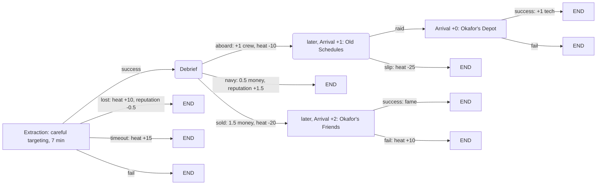
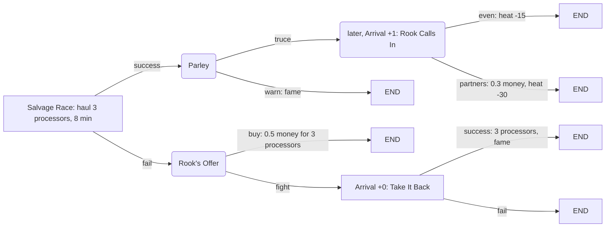
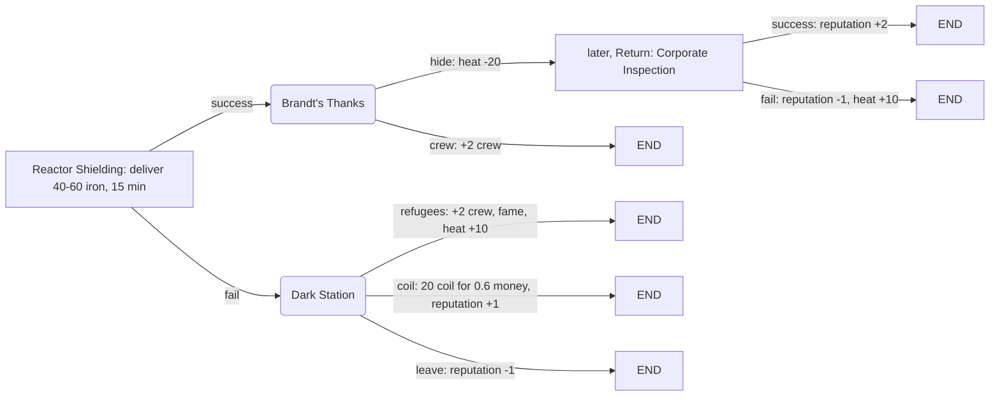
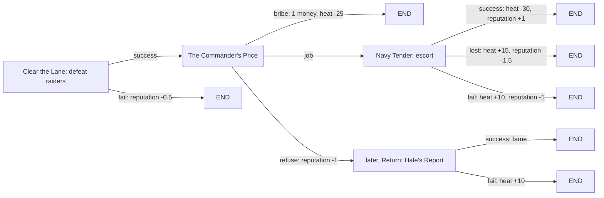
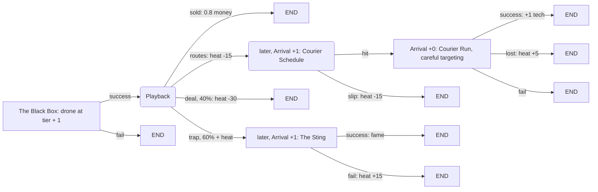

# Hot Cargo chains

Story chains: missions in parts, one chain per station. Spec requirements 160 to 175 (`spec/25-chains.md`) describe the system. This file holds the design and the catalog.

The content files are the source of truth: `mod/chains/chains.rules` (chains, stages, result rows), `mod/chains/missions.rules` (stage missions) and `mod/chains/pages.rules` (choice pages). When you change a chain, update its graph here.

## 1. Goals

- A station has a story. You come back to it, and it remembers what you did.
- Every stage ends in a result that matters: success, a failure kind, or a choice. The next stage depends on that result.
- Consequences show up later: a station that sends collectors, a rival who returns, a standing price, a defector's friends.
- Stages use Cosmoteer mechanics: escort, careful targeting, mining, salvage hauling, guarded wrecks, depots, ambushes.
- Chains use the Hot Cargo world: fences, the corporation, rival thieves, desperate stations, defectors and corrupt officers.

## 2. How chains work

### Assignment

- When the players first enter a system, each trade or military station of a faction gets one chain (chance `Chains.StationChance`, default 0.6), until `Chains.MaxNewChainsPerSystem` (default 2) stations of the system have one. In sector 1 the station nearest to the fleet always gets one first, so the first station of a run offers a story chain. The Buyer and hostile stations get none.
- The pick is weighted (`Weight` in chains.rules) among chains whose `MinSector`, `MaxSector` and `Stations` fit. Only the chains that the run used least often take part, so no chain repeats while an unused one fits.
- The first stage of every chain is a mission offer in the station's comms. The players choose to start the chain.

### Stages

| Kind | Where | Starts |
|---|---|---|
| Mission | Station | The offer shows in the station's comms, in the "Story Chains" category. A declined or expired offer comes back on the next visit. |
| Mission | Return, Arrival | The mission goes straight into the mission log, near the station or the fleet. The event window shows the stage title and briefing. |
| Page | Station | The choice window opens when a player ship comes within `PageTriggerDistance` (1,500) of the station. |
| Page | Return, Arrival | The choice window opens `LaterDelaySeconds` (8 s) after the system switch. |

- **Return**: the next time the players enter the station's system, after they left it.
- **Arrival**: the first arrival in a new system, `AfterSectors` sectors after the stage began. `AfterSectors = 0` starts the stage in the current system, 8 s after it began.

### Results

- A mission stage gives `success`, `timeout` (a time limit ran out), `lost` (a protected ship died), `abandoned` (the players abandoned it in the log) or `fail` (any other failure).
- A page gives the `ChainResult` of the outcome that the players got. A page outcome can also lead to a follow-up page.
- The stage's result rows handle the result: the first row whose `On` matches and whose chain flags hold wins. `timeout`, `lost` and `abandoned` fall back to `fail`. Every result falls back to `any`.
- A row applies its consequences, adds its story line, and moves to `Next`. An empty `Next` ends the chain.

### Consequences

| Consequence | How |
|---|---|
| Money, money in tech value, fame, heat, tech, crew, resources, hull damage, spawned ships, event flags | `Effects` on a row, or the outcome of a page. Same units as events (EVENTS.md section 2). Gains split between the players. A loss comes from the player who chose, or from the richest player for a mission result. |
| Reputation with the station's faction | `Reputation` on a row, in standard mission reputation at the sector tier. Vanilla prices and police follow reputation. |
| Open or close branches | Chain flags: `SetFlags` and `ClearFlags` on a row, `IfFlags` and `NotFlags` on later rows of the same chain. |
| Change what later stages spawn | The graph: each result leads to its own stage, with its own mission. |
| Later consequences | Return and Arrival stages: collectors at the station, inspectors, a rival fleet, a hit squad. |
| A better price at the station | A page stage that leads back to itself: a standing offer that opens on every visit. |
| Effects on random events | Event flags, for example `fake_codes` for the Corporate Checkpoint event. |

### Presentation

- Comms: a chain stage offer is named "[Chain] <chain title>: <stage title>" with "[Chain]" in gold. Its description is the stage brief: what to do, then the catch. Its reward list has a gold "Story chain, part N" line; its tooltip shows "So far:" and the last story lines.
- The comms mission list and the mission log group chain stages in their own category, "Story Chains".
- Chain pages and results use the event window. A result that leads to a page at the station shows above that page, so the window goes straight on.

## 3. Catalog

Graph legend: rectangles are missions, rounded boxes are pages, edges are results, `END` ends the chain. "later" marks a Return or Arrival stage.

### 3.1 The Fence's Ledger (trade stations)

Mara Quell keeps the books for half the fences in the sector.

Reads as: protect the freighter and get a fence's price for the rest of the run, or fail her and pay, in money, tech or blood.

### 3.2 The Quiet Defector (any station)

Sabine Okafor ran supply schedules for the hunter fleets.

Reads as: shoot the escorts, not the transport. Then decide who she is to you, and live with who comes for you later.

### 3.3 The Magpies' Rivalry (any station)

Captain Rook's crew of rival thieves.

Reads as: win the race and gain an ally who warns you later. Lose it and pay, or fight her whole crew now.

### 3.4 Lights Out (trade stations)

Station master Ilse Brandt refused to report you, and the corporation cut her repair shipments.

Reads as: mine or buy ore against the clock. Hiding at the station costs nothing now and brings the corporation to Brandt's door later.

### 3.5 The Commander's Price (military stations)

Commander Hale has the corporation's request for your hull number on her desk.

Reads as: pay, work or refuse. Each answer changes heat, and a refusal brings a hunter team to her station.

### 3.6 The Black Box (any station)

A dead hunter's flight recorder.

Reads as: the corporation's own data is worth money, safety or a crate. Selling it back to them is a gamble that gets worse with heat.

## 4. Stage missions

| Mission (missions.rules) | Where | Mechanic | Objectives |
|---|---|---|---|
| `ChainEscort` | Station | Escort | Freighter to a jump point past 2 to 3 raiders (HotCargoEscort, ProtectShips), payment at the station. |
| `ChainCarefulTarget` | Station | Careful targeting | 7 minutes: destroy 2 escorts, keep the hostile transport whole (ProtectShips), payment at the station. |
| `ChainCourierHit` | Arrival | Careful targeting | As above, near the fleet, no payment trip. |
| `ChainMine` | Station | Mining | 15 minutes: deliver 40 to 60 iron to the station. |
| `ChainSalvageRace` | Station | Salvage | 8 minutes: haul 3 processors from a drifting cargo pod to the station; 2 rival ships (hunter AI) guard it. |
| `ChainClearRaiders` | Station | Combat | Defeat 2 to 3 raiders near the station, payment at the station. |
| `ChainBlackBox` | Station | Combat | Defeat a tier + 1 security drone (hunter AI) at a hunter wreck, payment at the station. |
| `ChainStationRaid` | Return | Defend | Defeat 2 corporate ships (hunter AI) near the station. |
| `ChainAmbush` | Arrival | Combat | Defeat a rival fleet (hunter AI) that drops in near the fleet. |
| `ChainDepot` | Arrival | Combat | Destroy 2 defense platforms and a guard ship. |

Contract terms (spec 164): each Station stage has `Terms` (a `HotCargoContract`), so the same mission can cost differently in two chains. Return and Arrival missions carry zero terms.

## 5. Content rules for authors

- Start every chain with a Station mission. The players choose to start a chain.
- Give each chain at least one failure branch and one choice branch. Keep it to 3 to 5 stages.
- Every mission stage needs rows that handle `success` and `fail` (or `any`). Add `timeout` and `lost` rows when they tell a different story.
- Write one short story line per row, in the past tense, for "So far:". The last two lines show.
- Page titles start with the chain title. Every page outcome has a `ChainResult` or a `Next`.
- Give a page a safe choice when it has costs. Use `Need { Tech = 1 }` next to every tech cost, like events.
- Put Return and Arrival stages where a consequence should feel earned, not random.
- Validation runs at the first chain check and shows errors in the overlay. Chains then stay off until the game restarts.
