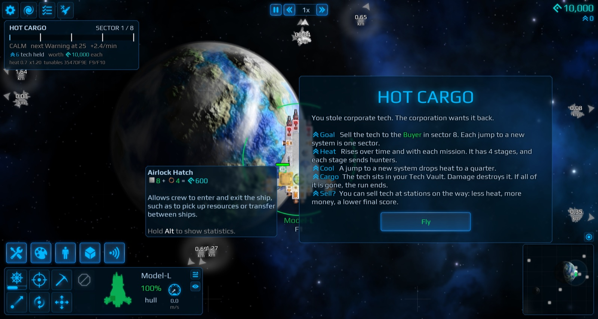
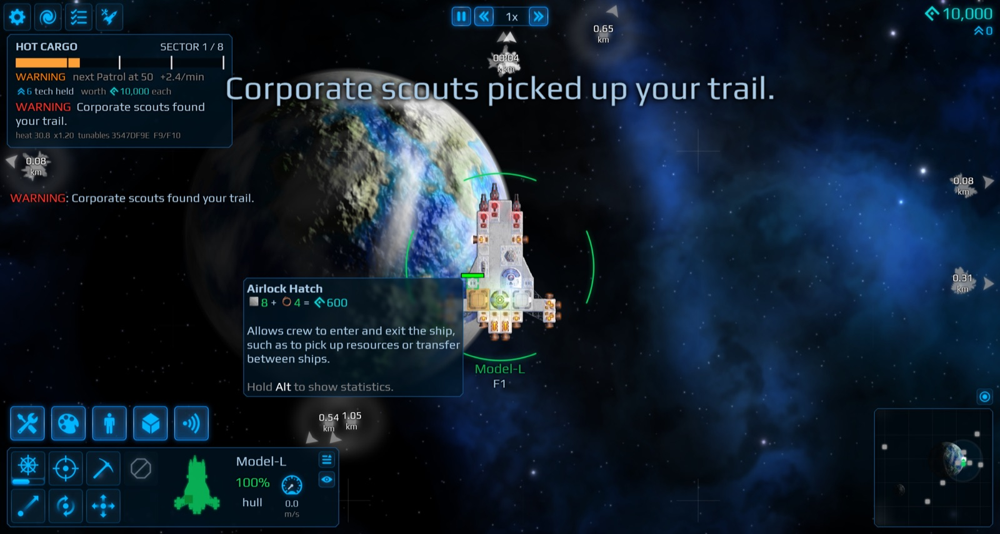
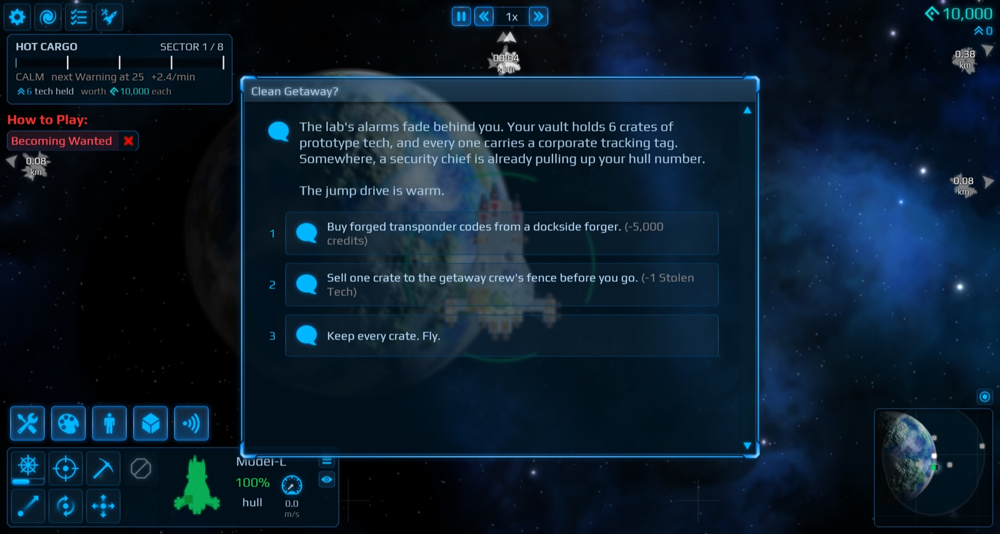
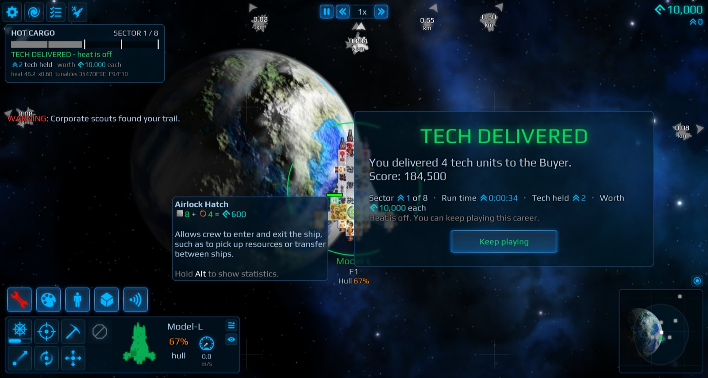
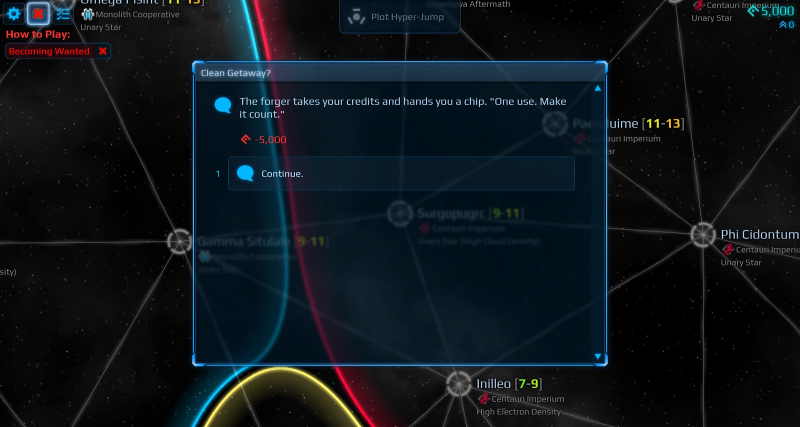
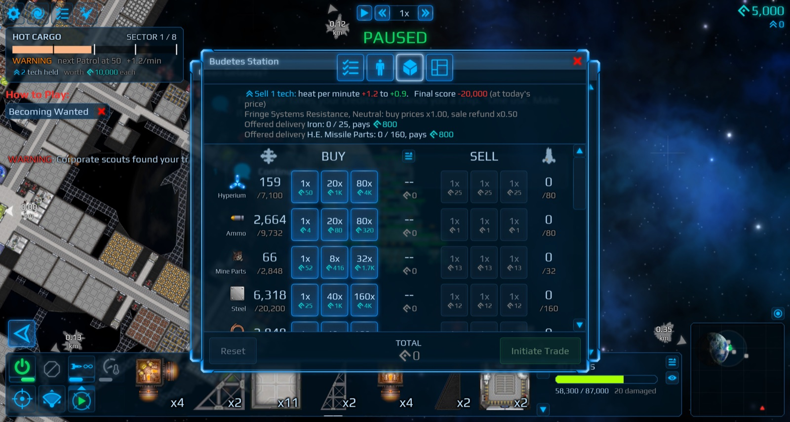

# Hot Cargo

A career mod for [Cosmoteer](https://store.steampowered.com/app/799600/Cosmoteer_Starship_Architect__Commander/) that turns the open-ended career into a short, tense run, like FTL.

You stole corporate tech. The corporation wants it back. Get it across about 8 systems to the Buyer before the hunters catch you.

## How it plays

- **Hold or sell.** You start with 8 units of Stolen Tech in a Tech Vault. Each unit you hold makes the corporation hunt you harder. Each unit you sell at a station gives you money now, and the price only rises as the run goes on: one or two units pay for a new ship of your stage. The Buyer pays 4× the price, and unsold units count the same in the score.
- **Move on or burn.** Heat grows over time and with every mission you finish. Heat stages send corporate hunter waves that kite, flank, bait and go for your guns. A jump to a new system cools you down.
- **Protect the cargo.** Hits on the vault destroy tech. If your tech reaches 0, the run is over.
- **Deliver.** The Buyer waits in the last sector. Sell it your tech to win.
- **New missions.** Convoy escorts, joint strikes with allied fleets, and shady bounties that may be corporate traps.
- **FTL-style events.** Distress beacons, corporate checkpoints, fences, rival thieves and more: choices with risks, costs and rewards.
- **Story chains.** Each station has a story in parts: a fence, a defector, a rival crew, a dark station. What you do in one part decides the next, and some choices come back to find you later.

It also improves some of the base game's UI. You can switch off each change in `tunables.rules`:

- Hull % on ships.
- Alerts when you lose a ship.
- Fixed mission distances for other systems.
- Richer galaxy map tooltips.
- A clearer fame tooltip.

## Install

Windows, Cosmoteer from Steam, game version 0.30.5a.

1. Download the latest zip from [Releases](https://github.com/Yarden-zamir/cosmoteer-hot-cargo/releases).
2. Close Cosmoteer, unzip, and double-click `install.bat`.
3. In Cosmoteer, open **Mods**, turn on **Hot Cargo**, and restart the game when it asks.
4. Start a new career. The map size "Hot Cargo run" is the default.

In co-op, every player needs the same version. Run `install.bat` again after a Cosmoteer update. `uninstall.bat` restores the game. `INSTALL.md` in the zip has the details.

## Tuning

All numbers live in `Mods\hot_cargo\tunables.rules`. The game reloads the file while it runs. `tunables.defaults.rules` lists every value with its default.

## Develop

- [SPEC.md](SPEC.md): the design and the numbered requirements.
- [CONTRIBUTING.md](CONTRIBUTING.md): the build, the test setup (headless game instances on a Windows PC) and releases.
- [PLAYTEST.md](PLAYTEST.md): manual checks.
- [CHAINS.md](CHAINS.md): the story chains and their graphs.

## License

[MIT](LICENSE)
