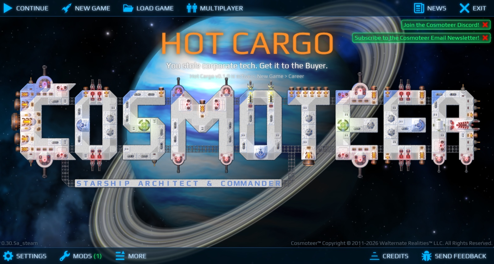
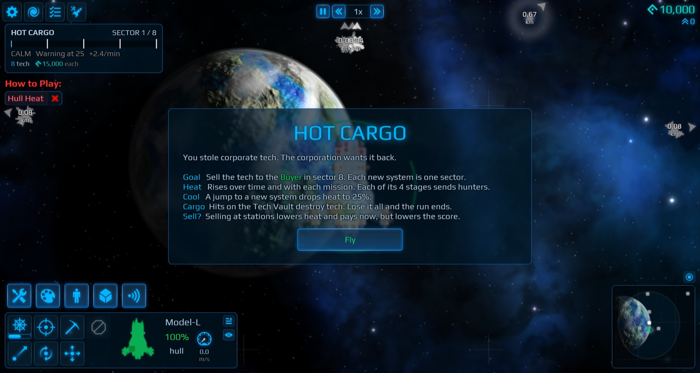
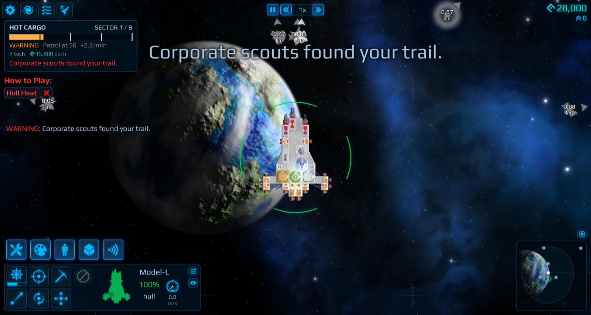
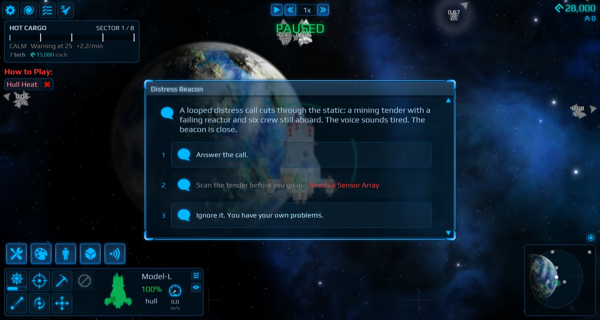
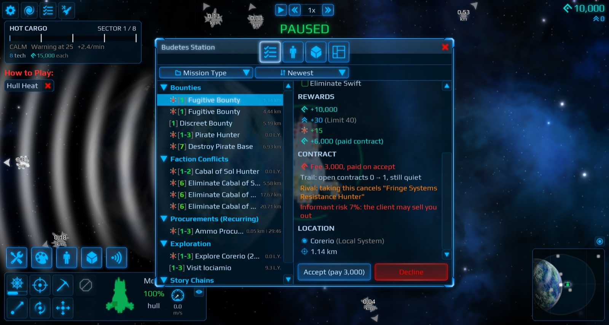
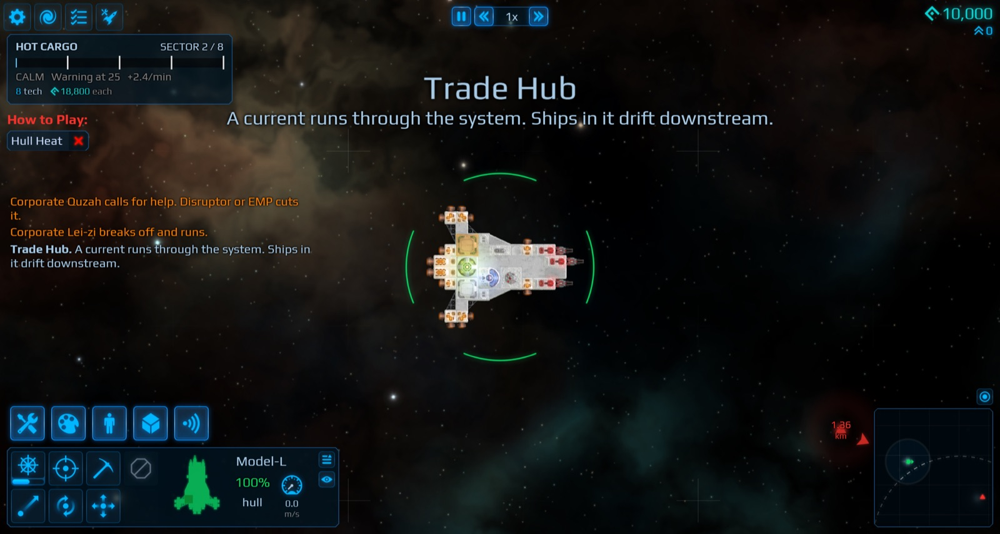
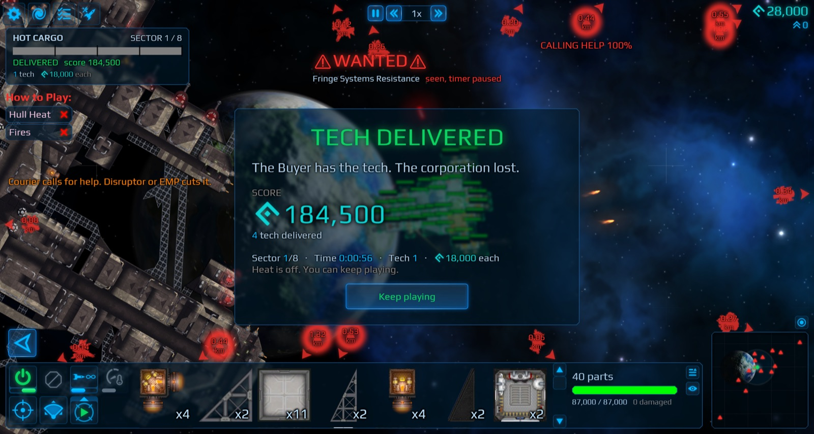
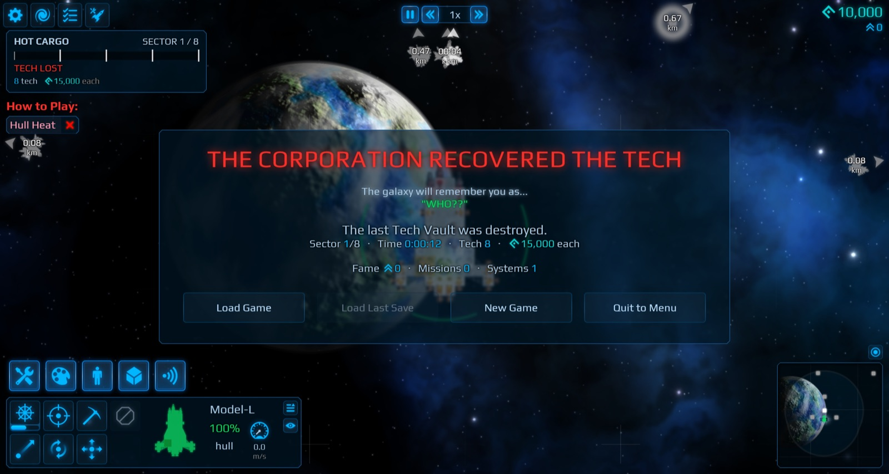
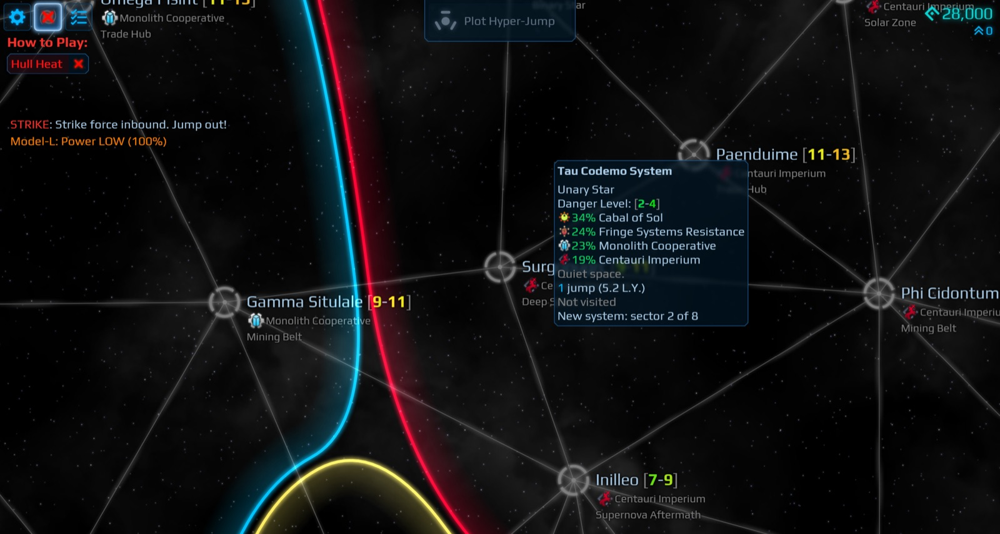
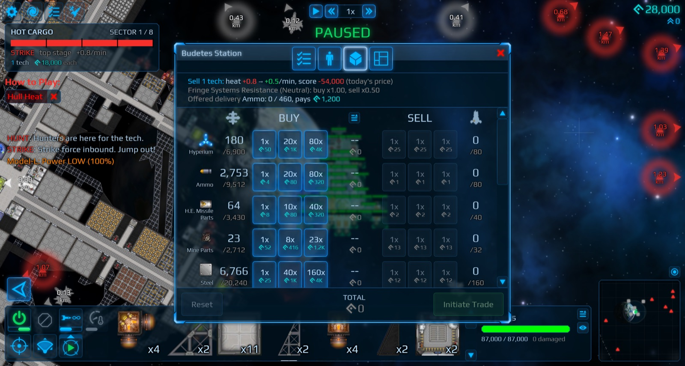

# Hot Cargo

A career mod for [Cosmoteer](https://store.steampowered.com/app/799600/Cosmoteer_Starship_Architect__Commander/) that turns the open-ended career into a short, tense run, like FTL.

You stole corporate tech. The corporation wants it back. Get it across about 8 systems to the Buyer before the hunters catch you.

## How it plays

- **Hold or sell.** You start with 8 Stolen Tech in a Tech Vault. The more you hold, the harder the corporation hunts you. Stations pay for tech now, and the price rises as the run goes on: one or two units buy a new ship of your stage. The Buyer pays 4× the price, and unsold units count the same in the score.
- **Move on or burn.** Heat rises over time and with every mission. Each heat stage sends corporate hunters that kite, flank, bait and go for your guns. A jump to a new system cools you down.
- **Protect the cargo.** Hits on the vault destroy tech. Lose it all and the run is over.
- **Deliver.** The Buyer waits in the last sector. Sell it your tech to win.
- **New missions.** Convoy escorts, joint strikes, shady bounties that may be traps, sieges, salvage, sundives and more.
- **Contracts.** Some clients charge a fee, some are rivals, and some sell you out to the corporation.
- **Sector types.** Trade hubs with currents, mining belts, solar zones and ion storms, each with its own hazard.
- **FTL-style events.** Distress beacons, checkpoints, fences, rival thieves: choices with risks, costs and rewards.
- **Story chains.** Each station has a story in parts. What you do in one part decides the next, and some choices come back later.

It also improves some of the base game's UI. You can switch off each change in `tunables.rules`:

- Hull % on ships, and alerts when you lose a ship or run low on supplies.
- Fixed mission distances for other systems.
- Richer galaxy map, fame and station tooltips.
- Number keys for dialogue options.

## Install

Windows, Cosmoteer from Steam, game version 0.30.5a.

1. Download the latest zip from [Releases](https://github.com/Yarden-zamir/cosmoteer-hot-cargo/releases).
2. Close Cosmoteer, unzip, and double-click `install.bat`.
3. In Cosmoteer, open **Mods**, turn on **Hot Cargo**, and restart the game when it asks.
4. Start a new career. The map size "Hot Cargo run" is the default.

In co-op, every player needs the same version. Run `install.bat` again after a Cosmoteer update. `uninstall.bat` restores the game. `INSTALL.md` in the zip has the details.

## Tuning

All numbers live in `Mods\hot_cargo\tunables.rules`. The game reloads the file while it runs. `tunables.defaults.rules` lists every value with its default.

## Develop

- [SPEC.md](SPEC.md): the design and the numbered requirements.
- [CONTRIBUTING.md](CONTRIBUTING.md): the build, the test setup (headless game instances on a Windows PC) and releases.
- [PLAYTEST.md](PLAYTEST.md): manual checks.
- [CHAINS.md](CHAINS.md): the story chains and their graphs.

## License

[MIT](LICENSE)
